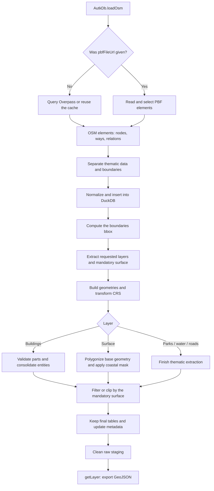
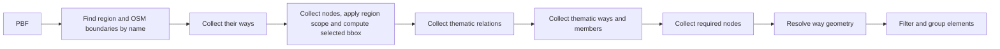
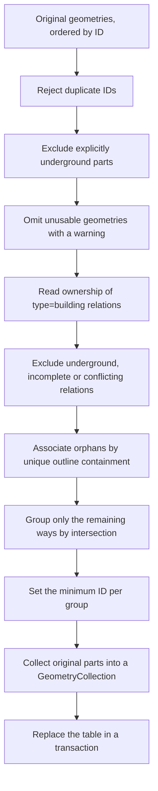

# OSM data import in Autark

This document explains the current implementation of `AutkDb.loadOsm()`, both through the Overpass API and from a PBF file. It covers acquisition, intermediate representation, geometry construction, relations, building grouping, clipping, export and cleanup.

**Reference:** code consolidated in commit `37f8a34`. The diagrams describe the implemented behavior, not planned features.

> **Core idea:** API and PBF differ in acquisition, but converge on the same model of OSM elements and the same spatial processing. Sharing the processing does not automatically make different snapshots or incomplete files equivalent.

## Contents

1. [Overview](#1-overview)
2. [Concepts and parameters](#2-concepts-and-parameters)
3. [Acquisition via Overpass](#3-acquisition-via-overpass)
4. [Acquisition via PBF](#4-acquisition-via-pbf)
5. [Common separation and normalization](#5-common-separation-and-normalization)
6. [Thematic classification](#6-thematic-classification)
7. [BBox and coordinate system](#7-bbox-and-coordinate-system)
8. [Construction of way geometries](#8-construction-of-way-geometries)
9. [Construction of relation geometries](#9-construction-of-relation-geometries)
10. [Building consolidation](#10-building-consolidation)
11. [Surface construction](#11-surface-construction)
12. [Final filtering and clipping](#12-final-filtering-and-clipping)
13. [Export and use by the map](#13-export-and-use-by-the-map)
14. [Temporaries, errors and cleanup](#14-temporaries-errors-and-cleanup)
15. [Source parity and diagnosis](#15-source-parity-and-diagnosis)
16. [Tests and code map](#16-tests-and-code-map)

## 1. Overview



If the viewer does not render Mermaid, the essential flow is:

```text
Overpass ── queries + cache ───────┐
                                 ├─ OSM elements ── DuckDB ── final layers
PBF ── decoder + local selection ─┘                         │
                                                          └─ GeoJSON ── map
```

### Representations along the process

| Moment | Representation | Example |
|---|---|---|
| API source | Overpass JSON; ways with inline coordinates | `nodes: [1,2,3,1]`, `geometry: [{lat,lon}, ...]` |
| PBF source | Compressed binary blocks | String table, nodes, dense nodes, delta-encoded refs |
| After reading | `OsmElement` objects | `{type: 'way', id, tags, nodes, geometry}` |
| Raw staging | DuckDB element tables | `table_osm`, `table_osm_boundaries` |
| Thematic extraction | One geometry per selected way, plus applicable relation areas | `table_osm_water` |
| Consolidated buildings | One row per entity, with original parts | `GeometryCollection` + `properties.parts` |
| Export | `FeatureCollection` | One feature per stored row |
| Rendering | Position and index buffers | Height extrusion and triangulation outside the import |

## 2. Concepts and parameters

### OSM vocabulary

| Concept | Meaning | Not to be confused with |
|---|---|---|
| **Node** | ID and coordinates of an OSM point | A vertex of a GPU mesh |
| **Way** | Ordered sequence of node references | Necessarily a polygon: it can be an open line |
| **Relation** | List of members, types, roles and tags | A ready geometry or a union of the members |
| **Role** | A member's function, such as `outer`, `inner`, `outline`, `part` | The way's thematic tag |
| **BBox** | Rectangle bounding an extent | The real administrative boundary |
| **Surface** | Polygons built from the requested boundaries | An elevation model or raster terrain |
| **Building feature** | Stored entity with its parts | An isolated part or all buildings that touch each other |
| **Snapshot** | State of the OSM data used in acquisition | A dataset necessarily equal to current OSM |

OSM IDs are separated by type: a node and a way can have the same number. That is why merging responses identifies elements by **`(type, id)`**, and staging keeps the `kind` column.

### Example through the API

```ts
await db.loadOsm({
  queryArea: {
    geocodeArea: 'New York',
    areas: ['Battery Park City', 'Financial District'],
  },
  outputTableName: 'table_osm',
  forceRefresh: true,
  autoLoadLayers: {
    layers: ['surface', 'parks', 'water', 'roads', 'buildings'],
  },
});
```

### Example from PBF

```ts
await db.loadOsm({
  pbfFileUrl: '/data/lower_mnt.osm.pbf',
  queryArea: {
    geocodeArea: 'New York',
    areas: ['Battery Park City', 'Financial District'],
  },
  // In this extract New York is incomplete: warning + selection by the areas names only.
  outputTableName: 'table_osm',
  autoLoadLayers: {
    layers: ['surface', 'parks', 'water', 'roads', 'buildings'],
  },
});
```

| Parameter | Current effect |
|---|---|
| `pbfFileUrl` | Chooses the PBF importer. Without it, Overpass is used. It is not an automatic fallback. |
| `queryArea.geocodeArea` | Administrative region that restricts `areas` in Overpass and, when its geometry is usable, in PBF. Without that boundary in the file, PBF warns and selects only by the exact `areas` names. |
| `queryArea.areas` | Exact names of the boundary relations to fetch. |
| `queryArea.bbox` | Alternative to named areas: `[west, south, east, north]` in WGS84, for Overpass or PBF. |
| `autoLoadLayers.layers` | Public layers extracted, in the given order. Surface is always built; if omitted, it stays hidden from the layer listing. |
| `autoLoadLayers.coordinateFormat` | Declared CRS of the input; default `EPSG:4326`. Does not change the CRS of the data at the source. |
| `outputTableName` | Table prefix; default `table_osm`. |
| `tagSets` | Overpass layers selected by tags, each set with a mandatory `type`: `points`, `polylines` or `polygons`. All of them go through the surface. Does not accept `pbfFileUrl`. |
| `forceRefresh` | Ignores the Overpass cache. Does not complete or update the PBF file. |
| `onProgress` | Receives the loading phases; it is not a progress percentage. |

The workspace uses `{ coordinateFormat: 'EPSG:3395', precisionGrid: 0.01 }` by default for storage; the grid represents 1 cm because this CRS is metric. To change the CRS, use `setWorkspace(name, { coordinateFormat, precisionGrid })` and provide both values, before loading tables into the workspace. The grid is expressed in the CRS units: do not use `0.01` for `EPSG:4326`. The public API uses the current workspace; internal options also receive its name explicitly. Loaded vector geometries are normalized to this grid after the CRS transformation; results of clips and coastal masks also use the grid. This can change coordinates and the vertex order of rings. Building parts are normalized individually, without dissolving or reordering the `GeometryCollection` components, preserving `geometryIndex` and attributes. A grid that collapses an input geometry or a whole part is rejected; small components/holes may disappear within the tolerance. Raster keeps its own resolution. Clips are transactional, with no retry; `loadGeojson` also undoes the creation/replacement of the table and its registration when there is an error.

**Preconditions:** `db.init()` must have been run. OSM must be loaded before non-OSM layers in the same workspace, since it establishes the spatial context.

The public selection accepts named areas or `queryArea: { bbox: [west, south, east, north] }`, both through Overpass and PBF. The bbox is validated before HTTP/reading: four finite coordinates within the WGS84 limits, `west < east` and `south < north`. Antimeridian crossing is not supported. The Overpass filter selects candidates; it does not promise an exhaustive geometric query of everything that intersects the box.

### Layers by tags and explicit type

```ts
await db.loadOsm({
  queryArea: { bbox: [-74.019, 40.700, -74.003, 40.714] },
  autoLoadLayers: { layers: [] },
  tagSets: [{ name: 'escolas', type: 'points', tags: [{ key: 'amenity', value: 'school' }] }],
});
// Only table_osm_escolas_points, if there are features after filtering.
```

Each set requires a single type and does not convert geometries: `points` accepts nodes, `polylines` accepts linear ways and `polygons` accepts area ways and `type=multipolygon` relations. A school mapped only as an area does not appear in a `points` set. Filters use OR, by key presence or exact value; there is no regex. Open ways are lines. Closed ways are also lines when `area=no` or when they have `highway`, `barrier`, `railway` or `waterway` without `area=yes`; other closed ways are areas. Relations of other types do not produce features.

Acquisition keeps members to assemble relations, but the final layer goes through the surface, including the coastal mask: external points are excluded; lines and areas are clipped; empty results and components incompatible with the type are discarded. This prevents an auxiliary member that is entirely external from surviving as an independent feature. An internal member with its own tags can still be a feature; there is no semantic deduplication between a relation and its members.

There are at most 8 sets, unique names in lowercase identifier format (up to 32 characters) and 1 to 64 filters per set. Keys have up to 255 characters and the format `[A-Za-z0-9][A-Za-z0-9_:.-]*`; values have 1 to 255 characters, without control characters. Invalid parameters and combination with PBF are refused before acquisition. Invalid ways or ways without all their coordinates are omitted with a warning; relation reconstruction keeps the existing limits of section 9. SQL errors and precision grid collapse are propagated.

A set produces only `<outputTableName>_<name>_<type>`. If it is empty after clipping, there is no table and no timing. A reload removes old tables of other types of the same set; sets omitted in the new call are not removed. Replacement, normalization and clipping of each set are transactional, restoring the previous table/metadata on error; the whole OSM load is not a single transaction. Per-element export uses the current explicit provenance, without inference from `refs`. Explicit nodes keep their tags even when they were already emitted as way vertices, without reordering the elements. `read_json` uses explicit column types so as not to depend on an initial sample made only of nodes.

Gallery example: [`osm-tag-sets.ts`](../gallery/src/autk-map/osm-tag-sets.ts), based on `osm-layers-pbf.ts`, using Overpass and the same named boundaries of Lower Manhattan.

## 3. Acquisition via Overpass

Responsible: [`LoadOsmFromOverpassApiUseCase`](../autk-db/src/use-cases/load-osm-overpass/use-case.ts).

### 3.1 Cache

Before querying the server:

1. Looks for an entry for the requested scope, areas and layers.
2. If needed, tries a full data entry as a superset.
3. Entries expire after **24 hours**.
4. `forceRefresh: true` ignores these entries.

The cache uses the browser's Cache API when available. Named area keys have version `v4`, invalidating old responses with an incorrect scope, including supersets. Bboxes keep `v3`, since their selection did not change; they have their own keys by coordinates and layers. Both include the data needed for the coastal mask and for `type=building` relations.

For `tagSets`, its own suffix `tag-sets-v1` includes the geometric types and canonical selectors. Names/order of the sets do not change acquisition; changing the type or the filters changes the key. The traditional superset does not contain all arbitrary nodes/tags and never serves a query with sets.

> A recent cache does not mean data equal to the PBF. It can represent another moment of OSM, and a reused full entry can contain more candidates than a specific thematic query.

### 3.2 Boundaries first

The query finds the region by name and, inside it, the OSM boundary relations matching the requested names (`boundary=administrative`, `boundary=place` and other named boundaries). Each relation produces its area through `map_to_area`; boundaries, thematic groups and all tiles use this same selection. No second global search for a homonymous area is made. It also fetches the member ways of these relations.

```text
geocodeArea
    └─ named areas
          ├─ boundary relations → out body
          └─ member ways        → out geom qt
```

- `out body` delivers the tags and member references of the relation.
- `out geom qt` delivers ways with inline coordinates.
- The bbox used to split the building queries is computed **only from the boundaries**.
- Parks, water and buildings must not enlarge this acquisition bbox.
- For a public bbox, there is no administrative query: a synthetic rectangular way establishes the boundaries and the extent.
- In both cases, an additional query collects `natural=coastline` in the area's extent, keeping complete ways and their direction.

The implementation requires the `boundary` tag and checks the presence of the requested names. It does not restrict its value to `administrative`: Battery Park City and Financial District, for example, use `boundary=place`. The scope criterion is a member node inside the region, as in Overpass's `relation(area)`, not full containment of the requested boundary; selected relations remain complete. Homonymous names inside the region itself can still match more than one relation.

### 3.3 Thematic queries

| Group | Acquisition | Note |
|---|---|---|
| Boundaries | One query for named areas; synthetic for bbox | Even without requesting the `surface` layer |
| Coastlines | One query over the area's extent | Always, regardless of the public layers |
| Parks + water | One joint query, with the active selectors | Can request only one of these themes |
| Roads | One query of ways | Road relations are not reconstructed as areas |
| Buildings | Normally four queries, in a 2 × 2 grid | Combines the area filter with each tile's bbox |
| Tag sets | One additional query for all sets | Nodes only for `points`; ways for lines/areas; multipolygon relations and their members only when there are `polygons` |

With the five layers, no cache and an available extent, there are normally **eight data queries for named areas**: boundaries, coastlines, parks/water, roads and four building tiles. For a bbox there are seven, without the boundary search. Status queries and retries are additional.

In the building tiles, a relation can appear in more than one response. Merging removes repetitions by `(type, id)`.

### 3.4 Relations and their members

For buildings, the queries include relations with:

- an accepted `building`;
- an accepted `building:part`;
- **`type=building`**, even without the two previous tags.

Then they fetch `way(r.dataRelations...)`: the member ways of the selected relations. These members may have no tags of their own or be outside the tile.

The same idea of collecting member ways is used in the parks/water relation queries. The collection is not equivalent to recursively resolving any nested relation.

### 3.5 Network, retries and result cache

The implementation:

- uses POST so as not to depend on the size of a URL;
- queries the Overpass status to wait for slots;
- keeps a 3 second pause between thematic requests;
- retries after network errors and HTTP `429`, `503` and `504`;
- uses backoff with jitter;
- reduces the declared timeout of the query after consecutive network/`504` failures;
- does not write the combined result to the cache when any requested group returns empty.

Declared query limits: 128 MiB for boundaries and 256 MiB for thematic groups/tiles. They are not the `maximum_object_size` limit of DuckDB's JSON reader.

At the end, the responses are merged and go on to the common processing.

## 4. Acquisition via PBF

Responsible: [`LoadOsmFromPbfUseCase`](../autk-db/src/use-cases/load-osm-pbf/use-case.ts) and [`osm-pbf-parser.ts`](../autk-db/src/use-cases/load-osm-pbf/osm-pbf-parser.ts).

For a public bbox, the importer directly uses the given extent and skips the phases of administrative discovery and boundary bbox computation. The existing thematic collection also keeps coastlines and their nodes, even without surface in the public list. Selected relations keep all the members available in the file. Missing/incomplete coastlines trigger the surface fallback, not an automatic external search.

### 4.1 Decoding

`@osmix/pbf` reads the blocks of the stream. The local parser converts:

| PBF structure | Conversion |
|---|---|
| String table | String indices → tag and role names/values |
| Regular nodes | ID, latitude, longitude and tags |
| Dense nodes | Accumulation of the ID/coordinate deltas and reading of the packed tags |
| Ways | Accumulation of the node reference deltas |
| Relations | Accumulation of the references and association between member, type and role |

A way initially contains references, not a ready geometry. After collecting the nodes, `resolveWayGeometries()` resolves the coordinates.

**Important limitation:** this resolver omits the coordinates of nodes that are not found; it does not recover data missing from the file. Therefore, completing the references at the source is essential, and reading a PBF should not be taken as proof of geometric completeness.

### 4.2 Three logical phases, six file reads

The logs call the procedure three passes, but each phase can read the stream more than once:

| Logical phase | Current reads | Product |
|---|---:|---|
| 1. Boundary discovery | 1 | Relations with a `boundary` tag and the names of the region and of the requested areas |
| 2. Scope and boundary bbox | 2 | Ways/nodes, reconstruction of the region polygon, selection by node membership and bbox of the selected boundaries only |
| 3. Thematic collection | 3 | Candidate relations, then ways, then required nodes |
| **Total** | **6** | Selected elements with resolved geometry |

Each read calls `fetch(pbfFileUrl)` and decodes the stream. This does not necessarily mean six full downloads over the network: the response can come from the HTTP cache. The importer, however, does not by itself keep a single binary copy for reuse between reads.



### 4.3 Candidate selection

First come boundary relations or relations matching the requested themes. Their way members are recorded.

Then come ways that:

1. belong to the boundary;
2. belong to a candidate relation; or
3. match the requested thematic tags.

Next, the nodes referenced by these ways are collected.

The implementation uses probabilistic `IdFilter` filters for several presence sets. They reduce the cost of tracking IDs, but can have false positives and keep additional candidates. They do not replace the later validation of a building's geometry or identity.

### 4.4 Spatial filter and member preservation

```text
candidate way
    ├─ is it a boundary? → keep
    └─ does its bbox overlap the boundaries bbox? → mark as intersecting

candidate relation
    ├─ is it a boundary? → keep
    └─ does it have any intersecting member way? → keep relation and available members
```

Then the nodes of the retained ways are kept.

The `wayIntersectsBbox()` test compares extent rectangles. **It is not an exact test of geometric intersection nor of membership in the administrative polygon.**

The file can contain all members of a relation, including those outside the area, or only some. The importer keeps the available members; it does not make an automatic Overpass query to complete the missing ones.

### 4.5 Grouping before the common flow

The elements are organized into boundaries, parks/water, roads and buildings; these groups are merged by `(type, id)`.

In grouping, boundaries have priority. Among themes, buildings come before roads and parks/water. Required nodes go with their groups.

Finally, the importer hands the combined set to the same `OsmProcessingPipeline` used by Overpass.

**Same criterion when the scope is available:** PBF tries to apply `geocodeArea` before defining boundaries and bbox. It reconstructs the region with open/reversed segments, disconnected components and holes, and selects OSM boundary relations whose name matches `areas` and which have some member node inside that geometry. Homonyms outside the region or inside its holes do not enlarge the bbox.

**Fallback for incomplete extracts:** if the region is missing or its geometry cannot be used, PBF emits `console.warn` and selects only the boundary relations with exact `areas` names present in the file, including `boundary=place`. It does not query Overpass to complete the scope and does not abandon loading for lack of that region. In this case homonyms from other regions inside the extract can be included; use a complete file or `queryArea.bbox` if you need to avoid that ambiguity. Names requested in `areas` that do not exist still cause an error. The gallery's `lower_mnt.osm.pbf` file has an incomplete New York geometry; its named example uses this fallback with a warning.

## 5. Common separation and normalization

Responsible: [`OsmProcessingPipeline`](../autk-db/src/internal/process-osm/pipeline.ts).

### 5.1 Separating boundaries from thematic data

`splitCombinedResponse()` identifies the relations of the requested names and their ways/nodes.

| Dataset | Content |
|---|---|
| `osmData` | Nodes, ways and relations that are not the relations of the requested boundaries |
| `boundariesData` | Boundary ways and their nodes |

Boundary ways and their nodes can also remain in `osmData`. What is removed from that dataset are the identified boundary relations.

This does not necessarily lose a thematic tag of a way that also belongs to the boundary.

### 5.2 Unifying API and PBF

```text
Overpass: way + nodes[] + inline geometry[]
                    │
                    ├─ emit node records from the inline coordinates
                    └─ emit the way record with refs[]

PBF: real nodes + way + resolved geometry[]
                    │
                    ├─ emit nodes once per ID
                    └─ emit the way record with refs[]
```

Nodes synthesized from `geometry[]` keep the OSM IDs referenced by the way. They are not new vertex IDs invented for the map.

### 5.3 Raw staging schema

```text
<workspace>.table_osm
<workspace>.table_osm_boundaries
```

| Column | Type | Use |
|---|---|---|
| `kind` | `VARCHAR` | `node`, `way` or `relation` |
| `id` | `BIGINT` | OSM ID in the namespace given by `kind` |
| `tags` | `MAP(VARCHAR, VARCHAR)` | Original tags and derived classification |
| `refs` | `BIGINT[]` | Nodes of a way or members of a relation |
| `lat`, `lon` | `DOUBLE` | Node coordinates |
| `ref_roles` | `VARCHAR[]` | Member roles, aligned with `refs` |
| `ref_types` | `VARCHAR[]` | Member types, aligned with `refs` |

The rows are serialized into temporary JSON, registered in DuckDB's VFS and inserted into the schema. Boundaries are inserted with `ignoreTags: true`, since their use is geometric.

The raw structure **does not yet have a `geometry` column per element**. That geometry is built in the extraction of each layer.

## 6. Thematic classification

Classification adds the internal tag `__autk_layer`. When an element matches more than one category, the precedence is:

```text
buildings > roads > parks > water
```

| Layer | Summary criteria |
|---|---|
| Buildings | `building` or `building:part` with a value that is not excluded; or `type=building` |
| Roads | Has `highway`, does not have `area=yes` and is not in the exclusion list |
| Parks | Selected values of `leisure`, `landuse` or `natural` |
| Water | Selected values of `natural` or `water` |
| Surface | Boundary ways; does not depend on thematic classification |

The effective lists are in [`consts.ts`](../autk-db/src/consts.ts):

| Rule | Current values |
|---|---|
| Parks / `leisure` | `dog_park`, `park`, `playground`, `recreation_ground` |
| Parks / `landuse` | `wood`, `grass`, `forest`, `orchard`, `village_green`, `vineyard`, `cemetery`, `meadow` |
| Parks / `natural` | `wood`, `grass`, `grassland`, `forest`, `scrub`, `heath`, `meadow` |
| Water / `natural` | `water`, `wetland`, `strait`, `spring` |
| Water / `water` | `pond`, `reservoir`, `lagoon`, `stream_pool`, `lake`, `pool`, `canal`, `river` |
| Excluded roads | `cycleway`, `elevator`, `footway`, `steps`, `pedestrian`, `proposed`, `construction`, `abandoned`, `platform`, `raceway` |
| Excluded buildings | `shed`, `garage`, `garages`, `carport`, `hut`, `kiosk`, `toilets`, `service`, `transformer_tower`, `sty`, `container` |

These rules are specific to the toolkit. They do not mean that every OSM element classified as water, vegetation or construction will be imported.

**Important exception for buildings:** member ways of `type=building` relations with an empty, `part`, `outline` or `outer` role enter the extraction even without tags of their own. This way the relation can provide identity and general attributes to parts that cannot be classified on their own. A member way with another role, such as `roof` or `column`, enters only by its own tags.

## 7. BBox and coordinate system

After inserting the staging, `AutkDb.loadOsm()` computes the bbox of the boundaries table.

```text
boundary nodes in EPSG:4326
        │
        ├─ MIN(lon), MIN(lat)
        └─ MAX(lon), MAX(lat)
                  │
                  └─ transformation to the workspace CRS, when needed
```

This bbox establishes the workspace context when it does not have a bbox yet. The current routine transforms the two extreme corners; it does not densify the edges to compute the extent in any arbitrary projection.

| Concept | Example | Stage |
|---|---|---|
| Geographic acquisition bbox | Degrees, `south/west/north/east` | Overpass tiles and PBF candidate filter |
| Workspace bbox | Coordinates in the stored CRS | Spatial extraction/clipping |
| Surface | Administrative polygon(s) | Final filtering/clipping |

The names `minLon` and `minLat` of the `BoundingBox` type are also used when the values are already projected X/Y. They must not be automatically interpreted as degrees.

Ways are transformed with `ST_Transform(..., always_xy := true)`. The input order is longitude/X, latitude/Y.

## 8. Construction of way geometries

Responsible: [`LOAD_LAYER_QUERY`](../autk-db/src/use-cases/load-osm-layer/queries.ts).

For each layer, the query:

1. selects its ways;
2. expands `refs`, keeping the index of each reference;
3. finds the nodes by ID, restricting the search to `kind='node'`;
4. creates points from longitude/latitude;
5. orders the points by the original index in the way;
6. builds a line or polygon and transforms the CRS.

```text
Way 10: refs = [101, 102, 103, 104, 101]
                    │
                    ▼
(way id, ref, position)
(10, 101, 0)
(10, 102, 1)
(10, 103, 2)
(10, 104, 3)
(10, 101, 4)
                    │ join with nodes
                    ▼
ordered points → ST_MakeLine → ST_MakePolygon, when applicable
```

| Layer | Initial geometry |
|---|---|
| Buildings / parks / water | Polygon if the first and last references coincide and there are more than three refs; otherwise, LineString |
| Roads | LineString |
| Surface | LineString, even for a closed way; polygonization happens later |

The extracted tables initially have `id`, `properties`, `refs` and `geometry`.

For parks/water, the given bbox is used in the geometric intersection during extraction. Roads/surface are built as lines without that same clip in the SQL expression; the final treatment by the surface happens in a later stage.

In the public OSM flow, **buildings do not receive a bbox to cut their parts before consolidation**.

Assembly by join is not a general certification of reference completeness. Incomplete source data needs to be investigated; the later building validation detects unusable geometry, but cannot discover every missing coordinate if the result still looks topologically valid.

## 9. Construction of relation geometries

Responsible: [`LoadOsmLayerUseCase`](../autk-db/src/use-cases/load-osm-layer/use-case.ts).

### 9.1 Areas composed of ways

Parks, water and building relations that are not `type=building` can produce area geometries.

```text
Multipolygon relation
    ├─ outer ways ── join segments by endpoints ── exterior rings
    └─ inner ways ── join segments by endpoints ── holes
                                                        │
                                                        ▼
                                                Polygon / MultiPolygon
```

Endpoints are compared by node references. Segments can be reversed to fit; the repeated junction node is removed when concatenating.

- Role `outer` or empty: candidate exterior ring.
- Role `inner`: candidate hole.
- One exterior ring produces a Polygon; several produce a MultiPolygon.
- For several exteriors, the association of a hole uses a point in ring test.
- The assembled geometry is transformed to the workspace and, when there is a bbox, intersected with it.

### 9.2 Limits of this reconstruction

There is no generic recursive reconstruction of nested relations. The area routine considers way members.

There is also **no universal rule here that "any missing member rejects the whole relation"**:

- segments without available ways/nodes are ignored in ring assembly;
- chains that do not close do not become rings;
- without an exterior ring, the relation is omitted and counted in the warning;
- a hole without a matching exterior can be omitted with a warning;
- if closed rings remain, a partial result can exist.

This differs from the more conservative building ownership policy described below. One must not assume that a reconstructed water area is complete just because it produced a Polygon.

### 9.3 `type=building` is ownership, not an extra multipolygon

A `type=building` relation is treated separately:

```text
type=building relation
    ├─ identity and general attributes
    └─ association of the original ways

It does not produce a second polygon overlapping its own ways.
```

This distinction avoids storing/rendering an additional area that duplicates building components.

## 10. Building consolidation

Responsible: [`ProcessOsmBuildingsUseCase`](../autk-db/src/internal/process-osm-buildings/use-case.ts).

### 10.1 Order of decisions



### 10.2 Validation and omission

| Situation | Behavior |
|---|---|
| `location=underground` part | Excluded before ownership/clustering, with a warning |
| `location=underground` relation | Relation and members are excluded from this layer |
| Missing, invalid, empty or non Polygon/MultiPolygon geometry | Part omitted, with a warning; coordinates are not repaired |
| Relation with a missing/unusable outline or part | Relation and its members are omitted, avoiding a partial building |
| Part intentionally excluded for being underground | Not treated as a geometry failure; the surface members can remain |
| Same way belonging to distinct relations | Affected relations are omitted, with a warning; no arbitrary owner is chosen |
| Duplicate IDs or SQL/transaction failure | Error propagated |
| Member with another role (such as `roof` or `column`) | Becomes a part when the building layer selects it by its own tags; otherwise it adds nothing, without omitting the relation |
| Conflicting roles or relation without members to draw | Warning and omission of the relation and of all its direct ways; other buildings continue |

When reading ownership, ways and multipolygons with an empty, `part`, `outline` or `outer` role are parts or outlines. A member with another role, such as `roof` or `column`, becomes a part when the building layer selects it by its own `building` or `building:part` tags; the others (roof `ridge` lines, untagged areas) add nothing and do not become independent buildings. Node members, such as labels, do not become geometric parts. Repeated references with the same role are deduplicated. Invalid membership is marked with a reason for omission, keeping all the IDs of the direct ways, including those after the invalid member. Consolidation logs `console.warn` with the relation ID and the reason and prevents its members from reappearing as partial/independent buildings. Database/transaction errors and internal invariants are still propagated; there is no generic catch hiding failures of the whole layer.

**Not excluded on their own:** zero height, negative `layer` or `building:levels:underground`. The specific exclusion of this stage requires `location=underground`.

### 10.3 Explicit ownership

A relation can associate disconnected parts or parts without tags of their own:

```text
Relation R
    ├─ way A: main body
    ├─ way B: roof component
    └─ way C: distant part

Result: one feature with [A, B, C], without requiring A ∩ C.
```

Distinct relations remain distinct entities even when their geometries overlap.

### 10.4 Orphan parts and conservative inference

A part without explicit ownership can be incorporated into a relation if:

1. it has `building:part` filled in and different from `no`;
2. its whole geometry is covered by an original outline;
3. the outlines covering it belong to **a single usable surface relation**.

The test is `ST_Covers(outline, part)`: it respects holes and allows contact with the edge.

Candidate outlines are:

- members with role `outline`; or
- members with an empty/`outer` role, a `building` tag filled in and different from `no`, and no active `building:part` indication.

Ordinary parts or already inferred parts are not used as new outlines.

| Case | Inferred association? |
|---|---|
| Whole part inside a single building | Yes |
| Contact with the edge, still fully covered | Yes |
| Several outlines of the same relation cover the part | Yes, the relation is counted once |
| Two distinct buildings cover the part | No; ambiguity warning |
| Only partial overlap | No |
| Part in a hole of the outline | No |
| Independent building without a part tag | No |
| Part already belonging to another relation | Ownership is not overwritten |

The inference is recorded separately in `osmRelation.inferredParts`; the original members of the relation are not falsified.

### 10.5 Clustering of the remaining elements

Ways still without ownership use `computeIntersectingClusterIds()`:

```text
A intersects B; B intersects C
                ↓
         cluster [A, B, C]

Even if A does not intersect C directly.
```

It is grouping by connected components of 2D intersection, with a spatial index. It does not automatically consider name, address, height, layer or cadastral identity.

**Known limitation:** surface ways without an explicit association can still join independent entities through transitive contacts. Removing underground connectors and preserving relations reduces the demonstrated cases, but does not prove semantic identity for all of OSM.

### 10.6 Canonical storage

```text
Before: one row per part

id   geometry    attributes
10   Polygon A   height=12
20   Polygon B   height=25

After: one row per building

id=10
building_id=10
geometry=GeometryCollection[A, B]
properties.parts=[
  {id:10, geometryIndex:0, height:12},
  {id:20, geometryIndex:1, height:25}
]
```

The ID is normally the **smallest ID of the retained parts**, including inferred parts. It is not a cluster index nor necessarily the relation ID. If a relation with its own geometry and a way share the same number, the relation receives a negative internal key to avoid a collision; its real OSM identity remains in the provenance. Therefore, `building_id` must be treated as an opaque grouping key.

The parts are ordered by ID. The `geometryIndex` indices point to the geometries of the collection in the same order.

Own attributes stay in the parts. Attributes identical in all parts can be promoted to the building level; general relation tags are also incorporated. In the resolution for rendering, part attributes take precedence over general ones, including alternative groups of height/base tags.

```text
properties.osmRelation
    ├─ id: string
    ├─ members: original IDs/roles (type: 'relation' marks a multipolygon member)
    ├─ properties: original relation tags
    └─ inferredParts: IDs associated by outline-containment, when present
```

**There is no geometric union, convex hull or persistent `agg_geometry` column.** The temporary mapping file contains IDs and attributes, not a second copy of the coordinates. The collection is built from the geometries of the source table.

"Preserving the original geometry" here means not uniting or clipping the parts during consolidation. The coordinates go through the CRS transformation and the workspace precision grid; the ring representation can change. Normalization happens individually per component and keeps the part indices, without dissolving overlapping polygons.

## 11. Surface construction

Responsible: [`PolygonizeOsmSurfaceUseCase`](../autk-db/src/internal/process-osm-surface/use-case.ts).

```text
table_osm_boundaries
        │ extract ways as lines
        ▼
table_osm_surface, initially linear
        │ export to GeoJSON
        │ Turf polygonize
        ▼
closed polygons
        │ register temporary JSON in DuckDB
        ▼
table_osm_surface, replaced by polygons
```

Polygonization builds the base geometry: administrative polygons for named areas or a synthetic rectangle for a bbox. In both cases, [`coastalLandMask`](../autk-db/src/internal/process-osm-surface/coastline.ts) reconstructs the land region in the geographic extent and the final surface is the intersection of this mask with the base geometry.

The reconstruction keeps the OSM direction (land on the left), clips segments to the extent, splits the edges where they meet, polygonizes and classifies faces. Disconnected rings are organized by containment to preserve islands and holes. In the reconstruction, the coordinates of the mask network are quantized to `1e-10` degrees; after projection, mask, surface and thematic/building layers are normalized to the workspace grid. A missing, incomplete, ambiguous or invalid coastline produces `console.warn` and keeps the whole base geometry. Thus, an entirely maritime bbox without coastline also uses the rectangle. Lakes/rivers are not subtracted: they remain available for `water`. Network, reading and database errors are not treated as a coastal fallback.

| Without requesting `surface` | Requesting `surface` |
|---|---|
| Surface is built and kept as an internal mask | Surface is built and exposed as a public layer |
| Does not appear in `getLayersMetadata()` nor in the per-layer timings | Appears in the listing and in the timings |
| Other layers are filtered/clipped normally | Same clipping/filtering |

The internal mask stays registered and can be inspected with `getTablesMetadata()`/`getLayer()`. `workspaceCropLayer` keeps pointing to it to restrict later loads. **Behavior change:** omitting surface no longer disables the final clipping.

The `surface` does not necessarily keep way IDs: its polygonized table stores the geometry and properties of the resulting polygons.

## 12. Final filtering and clipping

After extracting the layers and building the mandatory surface, `AutkDb.loadOsm()` processes the other layers against it, regardless of the public exposure of the mask.

### Two different contracts

| Layer | Exclude external features? | Cut the geometry of a feature that crosses the boundary? |
|---|---:|---:|
| Buildings | Yes | **No** |
| Parks | Yes | Yes |
| Water | Yes | Yes |
| Roads | Yes | Yes |
| Tag sets: points | Yes | Not applicable |
| Tag sets: polylines / polygons | Yes | Yes, discarding components of another dimension |

```text
Building crossing the surface:

       inside | outside
     ┌────────┼───────┐
     │        │       │
     └────────┼───────┘
              │

Result: keep the WHOLE building.
```

For buildings, it is enough for the collection to intersect some surface geometry. Parts outside the surface can remain when they belong to the same building that intersects it.

For the other layers:

1. features without intersection are removed;
2. the geometry is intersected with the union of the surface polygons;
3. empty results are removed.

This path uses `ST_MakeValid` and `ST_Union_Agg` to prepare the clip. This **is not the union of building parts**: building consolidation remains without union/repair, and their filtering does not change their geometry.

If a layer was already intersected with the bbox, it can go through a second clip, now by the real surface.

## 13. Export and use by the map

`db.getLayer()` queries the table and assembles a `FeatureCollection`.

| Element | Export |
|---|---|
| Stored row | One feature |
| `geometry` | Serialized with `ST_AsGeoJSON` |
| `id` | `Feature.id`, when the table provides this field |
| `properties` | Stored attributes |
| Layer type | `__autk_layer` at the root of the collection |
| Internal marker at the feature level | Removed by the export use case |

The default export does not create a second grouped representation: the building is already consolidated in the database.

### 13.1 Opt-in export per OSM element

`await db.getLayer('table_osm_buildings', { osmElements: true })` separates the retained elements, without changing the storage or the default export. Each feature uses `id: 'way/201'` or `'relation/201'`, the element's own tags and `properties.osm_type`/`osm_id`; buildings include `building_id` to recover the association with the group. The generated identity keys take precedence over tags of the same name.

The internal JSON column `__autk_osm_elements` keeps type/ID, source tags and component index, without duplicating coordinates. In consolidation, the index follows `geometryIndex`; in export, the geometry comes from the currently stored component. Identity is not inferred from the size of `refs`. Multipolygon relations with their own geometry are exported as elements; association `type=building` relations do not produce a duplicate geometry/feature. The tags of an owning relation are not invented as tags of its members.

The coordinates are already transformed, normalized and filtered/clipped according to the contracts of the layer; this mode does not recover the OSM geometry before clipping nor elements omitted for being invalid. Surface, raster, non-OSM tables and tables without sufficient provenance keep the common export. `updateTable` conservatively invalidates the provenance of the whole layer, avoiding the assignment of old tags/indices to the changed geometry; reloading OSM restores the mode. Bbox and root marker remain as in the default export. The per-element order is `building_id` when applicable, OSM type and numeric ID.

**CRS:** `getLayer()` exports the stored coordinates; it does not automatically convert back to WGS84. In the default workspace, the result used by the map has projected `EPSG:3395` coordinates.

In rendering, `TriangulatorBuildings` resolves the parts by `geometryIndex`, inherits general attributes and extrudes heights. This extrusion is not an import stage in DuckDB.

A missing height can have a rendering fallback when configured; an explicitly zero or invalid height is not silently replaced by a random height.

Different identities need to be distinguished:

| Identity | Example | Meaning |
|---|---|---|
| OSM ID of a part | `289386871` | Original way |
| OSM ID of the relation | String in `osmRelation.id` | Association declared in OSM |
| Default `Feature.id` / `building_id` | Normally the smallest retained ID; negative on collisions between namespaces | Stored building |
| `Feature.id` with `osmElements` | `way/289386871` | Explicit OSM identity |
| Map selection index | Position of a component/feature in loading | Not necessarily an OSM ID |

To investigate selection, compare the parts of the selected feature and their ownership, not just the number shown by picking.

## 14. Temporaries, errors and cleanup

### Table lifecycle

| Resource | During the import | On success |
|---|---|---|
| `table_osm` | Thematic raw staging | Removed |
| `table_osm_boundaries` | Boundary staging | Removed |
| SQL temporaries for refs/nodes | Help assembling the layers | Reused/replaced; tied to the DuckDB connection |
| `table_osm_surface` | Lines, then polygons and coastal mask | Kept; hidden from the public layers when not requested |
| `table_osm_parks`, `_water`, `_roads` | Thematic layers | Kept |
| `table_osm_buildings` | Parts, then consolidated entities | Kept |
| Building mapping JSON | IDs and attributes to consolidate | VFS file removed in `finally` |

### Guarantees and limits

- Replacing the buildings table uses `BEGIN TRANSACTION`, `COMMIT` and `ROLLBACK`.
- The complete import of all layers **is not a single transaction**.
- After the importer returns its raw tables, `AutkDb.loadOsm()` wraps registration, bbox, extraction and clipping in `try/finally`.
- That `finally` tries to remove the two raw tables both on success and after a processing error.
- If a DROP fails, there is a warning; the metadata of that table is kept, and cleanup of the other one is attempted.
- Cleanup deliberately does not remove the final layers already created and does not mask the original processing error.
- Failures inside the importer, **before it returns the tables**, are not covered by that same `finally`.
- Subprocesses have their own temporaries and cleanup strategies. There is no general guarantee of rollback/removal of every intermediate resource for any failure point; for example, surface polygonization has its own sequence of DROP, registration and recreation.

### Returned metrics

`loadOsm()` returns element counts, processing times and entries per requested layer. The internal surface, when not requested, does not add an entry to the timings.

For traditional thematic layers, the `featureCount` of each entry is measured right after extraction, **before** the final clip; for surface, also before its polygonization. It is not necessarily the final count obtained by `getLayer()`. `tagSets` entries include `tagSet` and count the features **after** clipping and the removal of incompatible components; their time includes extraction, normalization and clipping, without HTTP.

## 15. Source parity and diagnosis

### What is common and what is different

| Aspect | Overpass | PBF |
|---|---|---|
| Source | Remote response, normally of the current state | Snapshot contained in the file |
| Specific cache | Combined cache with a 24h TTL | Does not use that cache; there can be an HTTP cache of the file |
| Scope discovery | OSM boundary relations by name inside `geocodeArea`, converted with `map_to_area` | Same criterion with a usable region geometry; otherwise, a warning and fallback to the boundary names of `areas` |
| Spatial preselection | Overpass area filters and building tiles | Overlap of way bboxes and retention of relations/members |
| Initial way geometry | Inline in the response | Resolved from nodes |
| External members | Member ways returned by the queries | Only members available in the file |
| Normalization and staging | Common pipeline | Common pipeline |
| Layer construction and CRS | Common code | Common code |
| Ownership and consolidation | Common code | Common code |
| Clipping and export | Common code | Common code |

### Conditions for equality

The comparison must control:

1. same OSM snapshot;
2. same boundaries, not just similar names;
3. same layers, order and parameters;
4. same input and workspace CRS;
5. complete references of the relevant ways, nodes and relations;
6. absence of old responses in the cache;
7. equivalence of the candidates actually acquired.

The last condition matters because the spatial selectors of the two importers are not identical implementations. A local bbox test is not by definition equivalent to the Overpass area filter.

**The guarantee exercised by the current tests is:** for equivalent selected inputs, the two source representations go through the public API and produce the same layer content. This is not a certification of identity between any live query and any arbitrary PBF.

Comparing collections must normalize the order of features when necessary. `getLayer()` does not promise a global ordering by ID.

### Two investigated examples

| Symptom | Cause found | Treatment |
|---|---|---|
| Building selection covered different entities between API and PBF | Overpass did not collect relations that were only `type=building`, losing ownership | Grouped/tiled selectors fixed and versioned cache |
| Top and body of the same building separated | `building:part` ways missing from the relation, but contained in the outline | Association by unique containment, with provenance |
| Smaller water area in the PBF | Upper New York Bay, relation `2389632`, with 45 of the 59 member ways missing in the investigated file | Do not invent coordinates; obtain a complete/equivalent extract |

The water case is an observation about `gallery/public/data/lower_mnt.osm.pbf`, not a universal PBF rule. A different file can have all the needed references.

### Checklist to investigate a difference

```text
1. Compare parameters and source/snapshot
2. Check cache and forceRefresh
3. Compare boundary relations and bbox
4. Compare elements by (type, id), tags and members
5. Check the completeness of the refs of ways and relations
6. Compare geometries before consolidation/clipping
7. Compare explicit ownership and inferredParts
8. Compare final layers by IDs, parts, geometry and attributes
9. Only then investigate triangulation, picking and rendering
```

Comparing total counts or images is not enough: two layers can have the same count and associate parts with different entities.

## 16. Tests and code map

### Tests related to the import

| File | Relevant coverage |
|---|---|
| [`building-import-pipeline.test.ts`](../autk-db/test/building-import-pipeline.test.ts) | PBF decoder, boundaries, bbox, normalization, staging, relations, public import, clipping, cleanup and parity of the five layers |
| [`building-model.test.ts`](../autk-db/test/building-model.test.ts) | Consolidation, WKB, attributes, inferred ownership, ambiguities and underground exclusion |
| [`building-roundtrip.test.ts`](../autk-db/test/building-roundtrip.test.ts) | GeoJSON import/export/update, IDs and geometry validation; it is an import route distinct from OSM |
| [`building-api.test.ts`](../autk-db/test/building-api.test.ts) | Public API and integration of building layers |
| [`geometry-collection.test.ts`](../autk-db/test/geometry-collection.test.ts) | Predicates and spatial behavior of collections in DuckDB |
| [`spatial-join-features.test.ts`](../autk-db/test/spatial-join-features.test.ts) | Joins by entity, preservation of IDs and absence of matches |

Parity uses a compressed synthetic fixture and the real selected snapshot of the gallery PBF, presented again as Overpass relations and inline ways. The remote responses are adapted in the tests; DuckDB, assembly, CRS, consolidation, clipping and export are real.

This **does not run a complete live Overpass query**, nor does it validate picking/GPU in the browser.

Commands at the root:

```bash
npm test -- autk-db/test/building-import-pipeline.test.ts
npm test -- autk-db/test
make verify
make package-validate
```

The database tests use DuckDB-WASM in Node and need access to the spatial extension. Do not assume offline execution without provisioning that extension.

### Where to find each stage

| Responsibility | Code |
|---|---|
| Public orchestration, context, final filter and raw cleanup | [`autk-db/src/db.ts`](../autk-db/src/db.ts): `loadOsm`, `clipLayerToLayer` |
| API queries, tiles, cache and retries | [`load-osm-overpass/use-case.ts`](../autk-db/src/use-cases/load-osm-overpass/use-case.ts) |
| PBF reads and selection | [`load-osm-pbf/use-case.ts`](../autk-db/src/use-cases/load-osm-pbf/use-case.ts) |
| Element decoder and way resolution | [`osm-pbf-parser.ts`](../autk-db/src/use-cases/load-osm-pbf/osm-pbf-parser.ts) |
| Separation, classification and normalization | [`process-osm/pipeline.ts`](../autk-db/src/internal/process-osm/pipeline.ts) |
| Staging schema and insertion | [`load-osm-overpass/queries.ts`](../autk-db/src/use-cases/load-osm-overpass/queries.ts) |
| Thematic rules | [`consts.ts`](../autk-db/src/consts.ts) |
| Boundaries bbox | [`get-osm-bbox/`](../autk-db/src/internal/get-osm-bbox/) |
| Way extraction SQL | [`load-osm-layer/queries.ts`](../autk-db/src/use-cases/load-osm-layer/queries.ts) |
| Per-layer configuration | [`osm-processing-config.ts`](../autk-db/src/use-cases/load-osm-layer/osm-processing-config.ts) |
| Relation assembly and ownership reading | [`load-osm-layer/use-case.ts`](../autk-db/src/use-cases/load-osm-layer/use-case.ts) |
| Building consolidation and inference | [`process-osm-buildings/use-case.ts`](../autk-db/src/internal/process-osm-buildings/use-case.ts) |
| Containment and GeometryCollection SQL | [`process-osm-buildings/queries.ts`](../autk-db/src/internal/process-osm-buildings/queries.ts) |
| 2D clustering of the remaining ways | [`autk-core/src/utils-geojson.ts`](../autk-core/src/utils-geojson.ts): `computeIntersectingClusterIds` |
| Surface polygonization | [`process-osm-surface/use-case.ts`](../autk-db/src/internal/process-osm-surface/use-case.ts) |
| GeoJSON export | [`get-layer/`](../autk-db/src/use-cases/get-layer/) |
| Geometry/attribute association for rendering | [`autk-core/src/building-feature.ts`](../autk-core/src/building-feature.ts) |

### Summary of the contracts

- API and PBF converge on the same processing after acquisition.
- References, types and roles are essential; collecting polygons with building tags is not enough.
- `type=building` provides ownership and attributes, not an extra overlapping geometry.
- A building stores its original parts in a single feature.
- Orphan parts receive inferred ownership only when containment is unambiguous.
- Buildings are filtered by the surface, but not cut.
- Other layers can be clipped and repaired in the clipping path.
- Missing data or different snapshots prevent claiming absolute parity.
- Import, spatial analysis and rendering are distinct stages.
