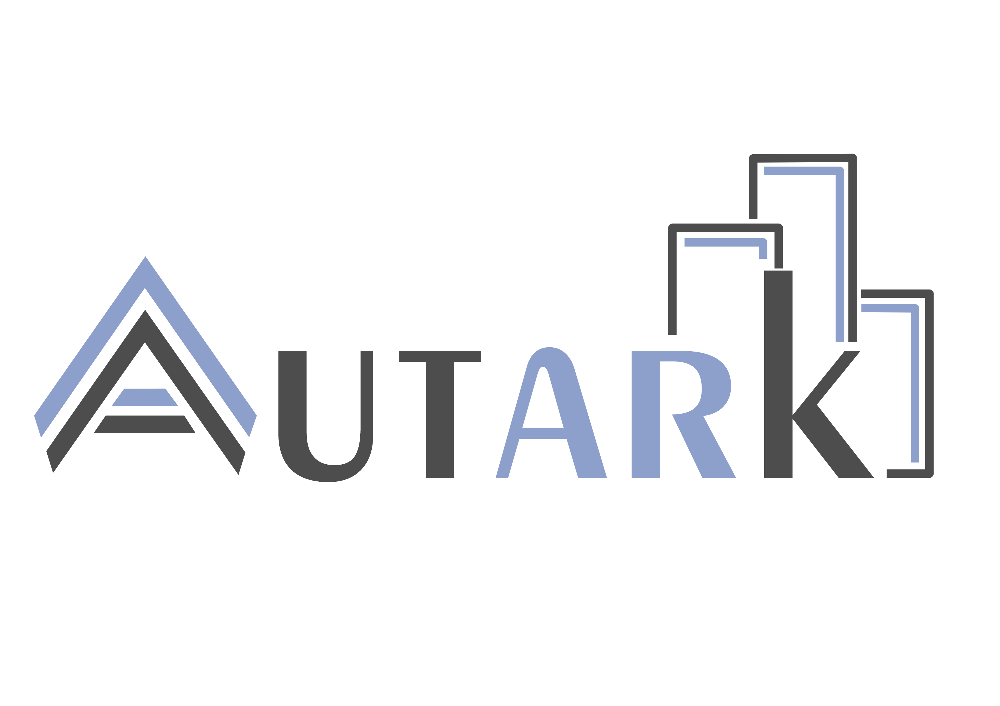

<div align="center">
  </br>

  <h1>@urban-toolkit/autk-core</h1>

  <br>
  <p><strong>Shared low-level runtime, geometry, camera, event, and color utilities for the Autark toolkit.</strong></p>

  <p>
    <a href="https://arxiv.org/abs/2604.20759">Paper</a> ·
    <a href="https://autarkjs.org/">Website</a>
  </p>  
</div>
<br>

## Autark toolkit

**Autark** is a serverless, modular TypeScript toolkit for prototyping urban visual analytics systems entirely in the browser. It supports client-side workflows for loading, storing, querying, joining, computing, and visualizing physical and thematic urban data using standard formats such as OpenStreetMap, GeoJSON, GeoTIFF, and CSV.

The toolkit is available as the umbrella package `@urban-toolkit/autk` or as individual modules:

* `@urban-toolkit/autk-core`: Shared low-level core package.
* `@urban-toolkit/autk-db`: In-browser spatial database for urban datasets.
* `@urban-toolkit/autk-compute`: WebGPU computation engine for analytical and render-based pipelines.
* `@urban-toolkit/autk-map`: WebGPU-based 2D/3D vector map visualization library.
* `@urban-toolkit/autk-plot`: D3.js-based plotting library for linked urban data views.

## @urban-toolkit/autk-core

`@urban-toolkit/autk-core` contains the shared low-level building blocks used by the other Autark packages. It is useful when you want direct access to color mapping helpers, camera primitives, triangulators, event utilities, or shared type definitions without going through the higher-level map, compute, db, or plot packages.

Use the higher-level packages when possible:

- use `@urban-toolkit/autk-map` for map rendering and interaction
- use `@urban-toolkit/autk-db` for data loading and spatial queries
- use `@urban-toolkit/autk-compute` for GPU compute and render-analysis workflows
- use `@urban-toolkit/autk-plot` for charts and linked plot interactions

Use `@urban-toolkit/autk-core` directly when you specifically need shared low-level primitives.

### Installation

```bash
npm install @urban-toolkit/autk-core
```

### Basic usage

```ts
import {
  Camera,
  ColorMap,
  ColorMapDomainStrategy,
  ColorMapInterpolator,
  TriangulatorPolygons,
  computeOrigin,
} from '@urban-toolkit/autk-core';

const origin = computeOrigin(buildingsGeojson);
const [geometry, components] = TriangulatorPolygons.buildMesh(buildingsGeojson, origin);

const camera = new Camera();
const colormap = ColorMap.getColorMap(
  ColorMapInterpolator.SEQ_VIRIDIS,
  16,
  [0, 100],
);

console.log(origin, geometry.length, components.length, camera.eye, colormap.length);
```

## API summary

`@urban-toolkit/autk-core` groups its exports around a few responsibilities:

- **Color mapping**: `ColorMap`, `ColorMapDomainStrategy`, `ColorMapInterpolator`, `ColorMapConfig`, `ResolvedDomain`
- **Transfer functions**: `DEFAULT_TRANSFER_FUNCTION`, `buildTransferContext`, `computeAlphaByte`
- **Camera utilities**: `Camera`, `CameraMotion`, `CameraData`, `CameraProjection`, `ViewProjectionParams`
- **Events**: `EventEmitter`, `EventListener`, `SelectionData`
- **Mesh types**: `LayerGeometry`, `LayerComponent`, `LayerBorder`, `LayerBorderComponent`
- **Layer and buffer types**: `LayerType`, `BoundingBox`, `TypedArray`, `TypedArrayConstructor`
- **Utilities**: `valueAtPath`, `isNumericLike`, `computeOrigin`, `computeGeometryCentroid`, `computeBoundingBox`, `isLayerType`, `mapGeometryTypeToLayerType`, `offsetPolyline`
- **Building features**: `normalizeBuildingFeature`, `BuildingPartProperties`
- **Geometry builders**: `PolylineBuilder`, `PolylineData` (width-independent centerlines for shader expansion)
- **Triangulators**: `TriangulatorPoints`, `TriangulatorPolylines`, `TriangulatorPolygons`, `TriangulatorBuildings`, `TriangulatorBuildingWithWindows`, `TriangulatorRaster`

The complete export list lives in [`src/index.ts`](./src/index.ts).

## Attribute paths

`valueAtPath(item, path)` traverses ordinary dot-delimited paths and resolves literal dotted leaf keys such as `sjoin.avg["shadows.jun"]` using the binding `sjoin.avg.shadows.jun`. Fully traversable nested paths take precedence when both forms exist. This shared accessor keeps database join output readable by map, plot and compute without reshaping the source data. Unknown paths still return `undefined`; zero, false and null are preserved.

## Building parts

`normalizeBuildingFeature(feature)` wraps original geometry in a GeometryCollection and validates `properties.parts[].geometryIndex`; it does not union, repair or clone coordinates. Legacy positional metadata is supported. General height/base attributes are inherited unless a part supplies its own tags, including explicit zero.

`TriangulatorBuildings` preserves building identity across its original parts. Window triangulation uses original roofs/rings and component-aware window IDs, not a convex hull.

Tests from the repository root: `npm test -- autk-core/test` (CPU only).

## Notes

- Geometry helpers assume planar coordinates unless a function states otherwise.
- `TriangulatorPoints.buildInstances()` produces positions and feature metadata only. Point radius belongs to `autk-map` render state (`updateRenderInfo(id, { renderInfo: { pointSize } })`); the global point-size setter/getter have been removed.
- `PolylineBuilder.build()` produces centerline topology and adjacency, independent of visual width, supporting nested line-bearing geometry collections. `autk-map` resolves line widths in render state and expands centerlines in its shaders. The legacy `TriangulatorPolylines.buildMesh()` API remains available for consumers that explicitly need buffered triangle meshes; the map no longer uses it.
- Triangulators convert GeoJSON and related feature data into render-ready mesh buffers.
- `@urban-toolkit/autk-core` is a stable shared dependency of the other Autark packages, but it exposes lower-level APIs than the higher-level modules.

## CRS transformations

`autk-core` owns the shared Proj4js registry and horizontal transformation utilities.
`registerCrs(name, definition)` accepts PROJ or WKT definitions. Transformations can run
between two projected CRSs as well as to or from longitude/latitude:

```ts
import { registerCrs, reprojectPosition, reprojectFeatureCollection } from '@urban-toolkit/autk-core';

registerCrs('MY:UTM23S', '+proj=utm +zone=23 +south +datum=WGS84 +units=m +no_defs');
const position = reprojectPosition([683000, 7460000], 'MY:UTM23S', 'EPSG:3395');
const projected = reprojectFeatureCollection(collection, 'MY:UTM23S', 'EPSG:3857');
```

For batches, `createCoordinateTransform(sourceCrs, targetCrs)` constructs a converter once
and returns a function accepting positions. Geographic coordinates always use
`[longitude, latitude]`; projected coordinates use `[x, y]`. Z and trailing values are
preserved, not converted between vertical datums. Collection conversion preserves IDs and
properties, handles nested geometries, and recomputes declared bounds from transformed
vertices. Inputs are not mutated; identical CRS names return the original collection.
Geometry is not densified and raster bands are not resampled.

The shared DB/map workspace default remains `DEFAULT_WORKSPACE_COORDINATE_FORMAT`
(EPSG:3395). There is no fixed supported-CRS list: both source and target definitions are
resolved by Proj4js, including geographic-to-projected, projected-to-geographic, and
projected-to-projected conversions. `isSupportedCrs()` validates through Proj4js rather than
a whitelist. `lonLatToCrs()` and `crsToLonLat()` also accept registered/custom definitions.
Unknown definitions, unsupported transformations, and non-finite coordinates throw. Additional EPSG definitions must be registered explicitly. Datum
transformations requiring external grids need those resources; an EPSG name alone does
not guarantee high-accuracy conversion. Geocentric inputs require a separate 3D workflow.

## Camera projection

`camera.setProjection('orthographic')` draws with parallel rays until `camera.setProjection('perspective')`, and `camera.getProjection()` reports which one the camera draws with. At the point the camera looks at, the orthographic view shows what the perspective view shows there, and zoom, pan, tilt and `resetCamera` keep working. `camera.setOrthographicBounds(left, right, bottom, top)` is a separate view: it looks straight down at a fixed rectangle of ground until `resetCamera` or `setProjection('perspective')`.

In an orthographic view, `getWorldRayDirection` gives every screen position the view direction, and the ray through a position starts at that position on the plane of the eye, not at `getEye()`. `getGroundPoint` gives where that ray meets the ground.

## Resources

- [Documentation](https://autarkjs.org/introduction.html)
- [Examples](https://autarkjs.org/gallery/)
- [Use Cases](https://autarkjs.org/usecases/)
