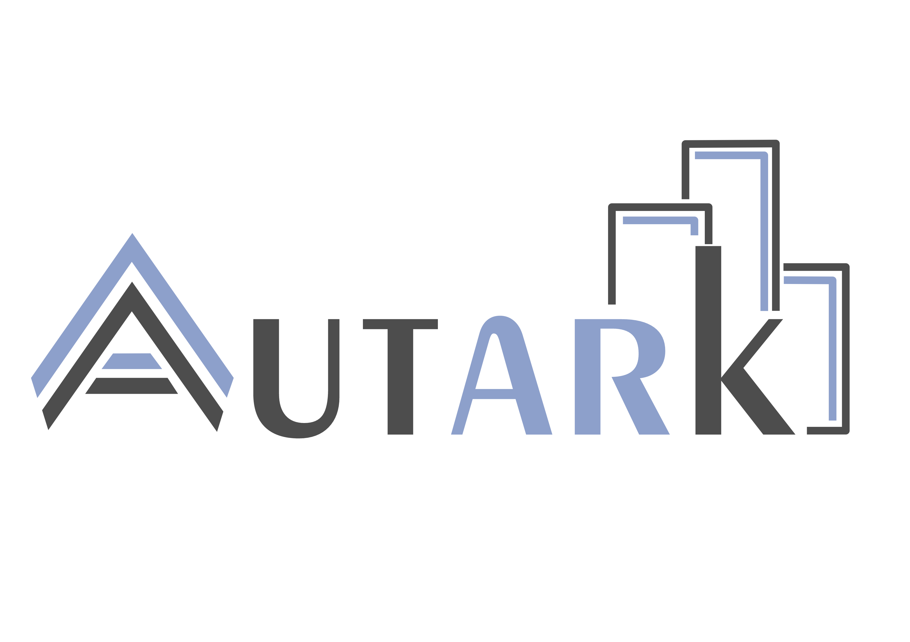

<div align="center">
  </br>

  <h1>@urban-toolkit/autk-plot</h1>

  <br>
  <p><strong>D3.js-based plotting library for linked urban data views.</strong></p>

  <p>
    <a href="https://arxiv.org/abs/2604.20759">Paper</a> ·
    <a href="https://autarkjs.org/">Website</a>
  </p>  
</div>
<br>

## Autark toolkit

**Autark** is a serverless, modular TypeScript toolkit for prototyping urban visual analytics systems entirely in the browser. It supports client-side workflows for loading, storing, querying, joining, computing, and visualizing physical and thematic urban data using standard formats such as OpenStreetMap, GeoJSON, GeoTIFF, and CSV.

The toolkit is available as the umbrella package `@urban-toolkit/autk` or as individual modules:

* `@urban-toolkit/autk-db`: In-browser spatial database for urban datasets.
* `@urban-toolkit/autk-compute`: WebGPU computation engine for analytical and render-based pipelines.
* `@urban-toolkit/autk-map`: WebGPU-based 2D/3D vector map visualization library.
* `@urban-toolkit/autk-plot`: D3.js-based plotting library for linked urban data views.

## @urban-toolkit/autk-plot

`@urban-toolkit/autk-plot` is a D3.js-based plotting library for visualizing GeoJSON feature properties. It provides a unified `AutkPlot` wrapper for multiple chart types, shared styling and colormap utilities, interaction events, selections, data updates, and transform presets for common aggregation workflows.

### Basic usage

```ts
import { AutkPlot, PlotEvent } from '@urban-toolkit/autk-plot';

const container = document.querySelector<HTMLElement>('#plot')!;

const plot = new AutkPlot(container, {
  type: 'scatterplot',
  collection: pointsGeojson,
  attributes: { axis: ['population', 'income'], color: 'zone' },
  labels: { axis: ['Population', 'Income'], title: 'Urban indicators' },
  events: [PlotEvent.CLICK],
});

plot.events.on(PlotEvent.CLICK, ({ selection }) => {
  console.log(selection);
});

plot.setSelection([0, 4, 10]);
```

### API summary

* `new AutkPlot(container, config)`: Creates a plot using the selected `type`.
* `type`: Returns the active plot type.
* `instance`: Exposes the underlying plot implementation for advanced use.
* `selection`: Returns selected source feature ids.
* `events`: Typed event bus for click, brush, and other supported plot events.
* `setSelection(selection, shares?)`: Applies a selection by source feature ids, optionally with the share of each feature covered in the emitting view.
* `updateCollection(collection)`: Replaces the source GeoJSON collection and redraws.
* `draw()`: Redraws the plot synchronously.
* `provenance`: Provenance graph of the current draw, from source features to marks.
* `destroy()`: Stops following the host size and removes the plot from its host.

Besides the attributes, labels and styling options, the config accepts:

* `width: 'auto'`: Fills the content width of the host and redraws when it changes, keeping the selection.
* `filter`: Keeps only the features that meet one or more conditions (`==`, `!=`, `>`, `>=`, `<`, `<=`, `in`, `not-in`).
* `topK`: Keeps the `k` largest rows, optionally gathering the rest in an "Others" row.
* `provenance: { path: true }`: Shows, under the plot, how many entities the selection reaches at each stage. Off by default.

### Supported plot types

* `scatterplot`, `barchart`, `parallel-coordinates`, `table`, `linechart`, `heatmatrix`
* `boxplot`, `sankey`, `pie`, `donut`, `areachart`, `bubble`, `hexbin`, `calendar`, `waffle`
* `stackedbar`, `treemap`, `sunburst`, `radar`, `ecdf`, `pareto`, `chord`, `density`, `violin`
* `registered`: a chart written in plain D3 and registered with `registerPlot`.

### Provenance and the segregated view

Every transform records weighted relations between its inputs and outputs, from the source features to the rendered marks, and classifies each step as 1:1, N:1, 1:N or N:N. Selections use them in both directions: an aggregated mark paints only the part produced by the selected features, and a mark selected in an aggregated view sends the share of each feature it covers. The relations extend the `autkIds` of the previous versions, which are kept unchanged.

### Transform API summary

`@urban-toolkit/autk-plot` also exports a shared transform layer for preparing plot data while preserving source-feature provenance through `autkIds` and explicit relations.

* `run(rows, config, channels)`: Runs a built-in transform preset.
* `reduceBuckets(params)`: Applies low-level bucket aggregation.
* Transform presets: `binning-1d`, `binning-2d`, `binning-events`, `reduce-series`, `sort`, `box-stats`, `flows`, `binning-hex`, `hierarchy`, `cumulative`, `fold`, and `density`.
* Reducers: `count`, `sum`, `avg`, `min`, and `max`.
* Time resolutions: `hour`, `day`, `weekday`, `monthday`, `month`, and `year`.

### Extending autk-plot

* `registerTransform(definition)`: Adds a transform with provenance, used as `{ preset: 'registered', name }`. `checkTransformReport` checks its six provenance invariants.
* `registerPlot(definition)`: Turns plain D3 drawing code into a chart, used as `{ type: 'registered', plot: name }`. The code only annotates its selectable marks (class `autkMark`, with their own row as D3 datum); selection, linking and the segregated view come with it, and the painted part is inferred from the geometry of the marks. `checkPlot` checks its six drawing invariants.

## Resources

- [Documentation](https://autarkjs.org/introduction.html)
- [Examples](https://autarkjs.org/gallery/)
- [Use Cases](https://autarkjs.org/usecases/)
