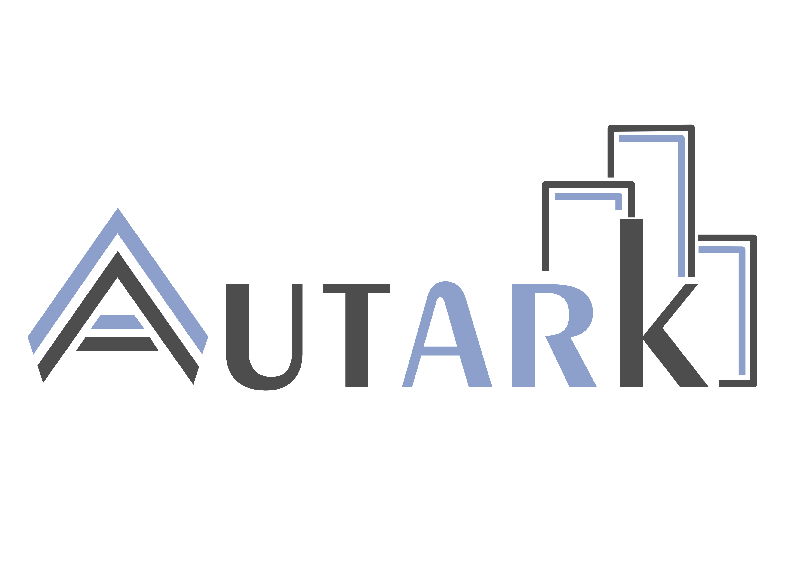

<div align="center">
  </br>

  <h1>@urban-toolkit/autk-plot</h1>

  <br>
  <p><strong>D3.js-based plotting library for linked urban data views.</strong></p>

  <p>
    <a href="https://arxiv.org/abs/2604.20759">Paper</a> ·
    <a href="https://autarkjs.org/">Website</a>
  </p>  
</div>
<br>

## Autark toolkit

**Autark** is a serverless, modular TypeScript toolkit for prototyping urban visual analytics systems entirely in the browser. It supports client-side workflows for loading, storing, querying, joining, computing, and visualizing physical and thematic urban data using standard formats such as OpenStreetMap, GeoJSON, GeoTIFF, and CSV.

The toolkit is available as the umbrella package `@urban-toolkit/autk` or as individual modules:

* `@urban-toolkit/autk-db`: In-browser spatial database for urban datasets.
* `@urban-toolkit/autk-compute`: WebGPU computation engine for analytical and render-based pipelines.
* `@urban-toolkit/autk-map`: WebGPU-based 2D/3D vector map visualization library.
* `@urban-toolkit/autk-plot`: D3.js-based plotting library for linked urban data views.

## @urban-toolkit/autk-plot

`@urban-toolkit/autk-plot` is a D3.js-based plotting library for visualizing GeoJSON feature properties. It provides a unified `AutkPlot` wrapper for multiple chart types, shared styling and colormap utilities, interaction events, selections, data updates, and transform presets for common aggregation workflows.

### Basic usage

```ts
import { AutkPlot, PlotEvent } from '@urban-toolkit/autk-plot';

const container = document.querySelector<HTMLElement>('#plot')!;

const plot = new AutkPlot(container, {
  type: 'scatterplot',
  collection: pointsGeojson,
  attributes: { axis: ['population', 'income'], color: 'zone' },
  labels: { axis: ['Population', 'Income'], title: 'Urban indicators' },
  events: [PlotEvent.CLICK],
});

plot.events.on(PlotEvent.CLICK, ({ selection }) => {
  console.log(selection);
});

plot.setSelection([0, 4, 10]);
```

### API summary

* `new AutkPlot(container, config)`: Creates a plot using the selected `type`.
* `type`: Returns the active plot type.
* `instance`: Exposes the underlying plot implementation for advanced use.
* `selection`: Returns selected source feature ids.
* `events`: Typed event bus for click, brush, and other supported plot events.
* `setSelection(selection, shares?)`: Applies a selection by source feature ids, optionally with the share of each feature covered in the emitting view.
* `updateCollection(collection)`: Replaces the source GeoJSON collection and redraws.
* `draw()`: Redraws the plot synchronously.
* `provenance`: Provenance graph of the current draw, from source features to marks.
* `destroy()`: Stops following the host size and removes the plot from its host.

Besides the attributes, labels and styling options, the config accepts:

* `width: 'auto'`: Fills the content width of the host and redraws when it changes, keeping the selection.
* `filter`: Keeps only the features that meet one or more conditions (`==`, `!=`, `>`, `>=`, `<`, `<=`, `in`, `not-in`).
* `topK`: Keeps the `k` largest rows, optionally gathering the rest in an "Others" row.
* `provenance: { path: true }`: Shows, under the plot, how many entities the selection reaches at each stage. Off by default.

### Supported plot types

* `scatterplot`, `barchart`, `parallel-coordinates`, `table`, `linechart`, `heatmatrix`
* `boxplot`, `sankey`, `pie`, `donut`, `areachart`, `bubble`, `hexbin`, `calendar`, `waffle`
* `stackedbar`, `treemap`, `sunburst`, `radar`, `ecdf`, `pareto`, `chord`, `density`, `violin`
* `registered`: a chart written in plain D3 and registered with `registerPlot`.

### Provenance and the segregated view

Every transform records weighted relations between its inputs and outputs, from the source features to the rendered marks, and classifies each step as 1:1, N:1, 1:N or N:N. Selections use them in both directions: an aggregated mark paints only the part produced by the selected features, and a mark selected in an aggregated view sends the share of each feature it covers. The relations extend the `autkIds` of the previous versions, which are kept unchanged.

### Transform API summary

`@urban-toolkit/autk-plot` also exports a shared transform layer for preparing plot data while preserving source-feature provenance through `autkIds` and explicit relations.

* `run(rows, config, channels)`: Runs a built-in transform preset.
* `reduceBuckets(params)`: Applies low-level bucket aggregation.
* Transform presets: `binning-1d`, `binning-2d`, `binning-events`, `reduce-series`, `sort`, `box-stats`, `flows`, `binning-hex`, `hierarchy`, `cumulative`, `fold`, and `density`.
* Reducers: `count`, `sum`, `avg`, `min`, and `max`.
* Time resolutions: `hour`, `day`, `weekday`, `monthday`, `month`, and `year`.

### Extending autk-plot

The 24 built-in plots and the 12 built-in transforms are registered with the same functions as yours, and drawn and run by the same code: none is privileged. Their definitions are reference examples: `registeredPlot('barchart')` and `registeredTransform('fold')` return them (frozen), and their sources in `src/plots` and `src/transforms/presets` use only public exports. Built-in names are reserved.

* `registerTransform(definition)`: Adds a transform with provenance, used as `{ preset: 'registered', name }`. Its rows have one of eleven shapes (`category-value`, `series`, `hierarchy`, `flows`…), and every plot that reads that shape draws them. `checkTransformReport` checks its six provenance invariants.
* `registerPlot(definition)`: Turns plain D3 drawing code into a chart, used as `{ type: 'registered', plot: name }`. The code only annotates its selectable marks (class `autkMark`, with their own row as D3 datum); selection, linking and the segregated view come with it, and the painted part is inferred from the geometry of the marks. Only `name` and `draw` are required; optional fields declare the design of the painted part, the series to redraw, the transforms and reducers the plot reads, and the style of a highlighted mark, and the drawing context offers axes, formats, a legend and tick counts. `checkPlot` checks its six drawing invariants.

### Writing a chart

A chart is plain D3 code. `draw` receives the rendered rows and a marks group; bind the rows themselves to the selectable marks and give them the class `autkMark`:

```ts
import * as d3 from 'd3';
import { AutkPlot, PlotEvent, registerPlot } from '@urban-toolkit/autk-plot';

registerPlot({
  name: 'dots',
  draw({ group, rows, value, width, height, axisX, axisY }) {
    // value(row, i) reads the i-th field of attributes.axis, nested paths included ('sjoin.count.noise').
    const x = d3.scaleLinear(d3.extent(rows, row => Number(value(row, 0))) as [number, number], [0, width]);
    const y = d3.scaleLinear(d3.extent(rows, row => Number(value(row, 1))) as [number, number], [height, 0]);
    axisX(d3.axisBottom(x));
    axisY(d3.axisLeft(y));
    group.selectAll('circle').data(rows).join('circle')
      .attr('class', 'autkMark')
      .attr('cx', row => x(Number(value(row, 0))))
      .attr('cy', row => y(Number(value(row, 1))))
      .attr('r', 4);
  },
});

new AutkPlot(container, {
  type: 'registered', plot: 'dots', collection,
  attributes: { axis: ['population', 'income'] },
  events: [PlotEvent.BRUSH],
});
```

`width` and `height` are the drawing area inside the margins (`margins` in the config). Besides `group` and `rows`, the context gives `html` (a container for HTML marks), `fields`, `format(i)`, `axisLabels`, `legend` and `tickCount`. Autark colors the marks (gray, and the selection color); style anything else by state with `markStyle`. Optional fields declare the transforms and reducers the chart reads (`transforms`, `requiresTransform`, `reducers`), the design of the painted part (`design`, or `drawPart`), and defaults and checks of the config (`defaults`, `validate`).

### Writing a transform

A transform turns one row per feature into the rows a chart draws, with their provenance: stages `D1…Dn`, weighted relations from the features (`D0`) to the rows, one id per row (`rowIds`), the units each row reduces (`contributions`), and the reducer. Public blocks build it: `collectBuckets` groups and reduces rows, and `binnedProvenance`, `unnestedProvenance` and `rowwiseProvenance` record the relations of a partition, of an unnest then partition, and of one row per feature.

```ts
import { AutkPlot, binnedProvenance, collectBuckets, indexedBins, registerTransform } from '@urban-toolkit/autk-plot';

registerTransform({
  name: 'by-initial',
  shape: 'category-value', // { label, value } rows: bar, pie, donut and waffle charts read them
  run(rows, options, columns) {
    const buckets = collectBuckets({
      rows, reducer: 'count', valueOf: undefined,
      bucketOf: row => String(row[columns[0]] ?? '').charAt(0) || null,
    });
    const keys = buckets.map(bucket => bucket.key);
    return {
      rows: buckets.map(bucket => ({ label: bucket.key, value: bucket.value, autkIds: bucket.autkIds })),
      provenance: binnedProvenance({ rows, buckets, bins: indexedBins(keys, keys, 'initial'), binLabel: 'initials', rowKeys: keys, reducer: 'count' }),
    };
  },
});

new AutkPlot(container, {
  type: 'barchart', collection,
  attributes: { axis: ['name', '@transform'] },
  transform: { preset: 'registered', name: 'by-initial' },
});
```

The sources of the built-in transforms (`src/transforms/presets`) are written the same way.

### Tests

The transform baselines run with the repository's Vitest suite. The plot tests draw and select in a real DOM, so they run in headless Chrome: run `npm run test:browser --workspace=@urban-toolkit/autk-plot` from the repository root (local sources through Vite, no downloaded fixtures; requires Node with built-in WebSocket support and Chrome; set `CHROME_BIN` if Chrome is not at the default macOS, Linux or Windows path). They keep Vitest's API; `test/harness.ts` runs them in the page with Vitest's own `expect`. `test/baselines/` holds the outputs of the original autk-plot 4.1.1, which the baseline tests compare against, and the snapshots of the hand-written plots each built-in plot reproduces (`natives.json`, recorded in Chrome; record again only on purpose with `AUTK_RECORD=1`).

## Resources

- [Documentation](https://autarkjs.org/introduction.html)
- [Examples](https://autarkjs.org/gallery/)
- [Use Cases](https://autarkjs.org/usecases/)
